# KẾ HOẠCH THỰC HIỆN LAB K4-TRACK-3A-DAY24: PRODUCTION EVAL + GUARDRAIL STACK
> **Chiến lược phân công nhóm 3 người — Triệt tiêu 100% rủi ro Git Merge Conflict**
> **Thành viên nhóm**:
> - **TV1 (Trưởng nhóm)**: Nguyễn Công Duẩn
> - **TV2**: Phùng Quốc Việt
> - **TV3**: Phan Hoàng Vũ

---

## 📌 1. TỔNG QUAN DỰ ÁN & MỤC TIÊU ĐIỂM SỐ

- **Mục tiêu**: Đánh giá pipeline RAG (50 câu hỏi), kiểm chứng độ tin cậy của LLM Judge (A/B testing & calibration), và xây dựng tầng Guardrails (Presidio PII + NeMo Guardrails + đo P95 Latency).
- **Quy định nộp bài**: 
  - Mỗi nhóm dùng và nộp **1 repo GitHub chung** theo định dạng: `K4-L3-DAY24-TenNhom-Eval-Guard`.
  - **Tất cả 3 thành viên đều bắt buộc phải có commit thật** mang tên mình trên GitHub.
  - Deadline mặc định: **23:59 ngày diễn ra lab** (Asia/Ho_Chi_Minh).
- **Thang điểm**: **100 điểm bắt buộc + 10 điểm bonus**.
  - **Phase A**: 30 điểm (+4 bonus: adversarial mean < factual mean, có phân tích bẫy).
  - **Phase B**: 35 điểm (+3 bonus: Cohen's $\kappa > 0.6$ trên đúng 10 `model_answer` nguồn).
  - **Phase C**: 35 điểm (+3 bonus: attacks $\ge 18/20$ và clean $8/8$ allowed).
  - **Task 13 (Blueprint)**: Nằm trong quỹ 100 điểm bắt buộc.

---

## 🛡️ 2. NGUYÊN TẮC VÀNG: "ZERO-CONFLICT GIT WORKFLOW"

Xung đột Git (merge conflict) xảy ra khi **2 người cùng sửa 1 file cùng lúc**. Để triệt tiêu 100% rủi ro conflict, nhóm áp dụng kiến trúc **File Ownership Tách Rời Hoàn Toàn**:

### 2.1. Phân chia File độc quyền (Mutually Disjoint Sets)
Mỗi thành viên chỉ được phép tạo nhánh, chỉnh sửa và commit trên **tập file độc quyền** của mình:

| Thành viên & Vai trò | Nhánh Git | Source File độc quyền | Report File độc quyền | Artifact sinh ra |
|:---|:---|:---|:---|:---|
| **TV1: Nguyễn Công Duẩn** *(Lead)* | `feature/phase-a-ragas` | `src/phase_a_ragas.py` | `doc/reports/failure_clusters.md` | `artifacts/ragas_50q.json` |
| **TV2: Phùng Quốc Việt** | `feature/phase-b-judge` | `src/phase_b_judge.py` | `doc/reports/bias_report.md` | `artifacts/judge_results.json` |
| **TV3: Phan Hoàng Vũ** | `feature/phase-c-guard` | `src/phase_c_guard.py` | `doc/reports/blueprint.md` | `artifacts/guard_results.json` |

> ⚠️ **Quy tắc tuyệt đối**: Không thành viên nào được chạm vào file thuộc quyền sở hữu của thành viên khác trong suốt quá trình code!

### 2.2. Chiến lược xử lý các file dùng chung (`doc/TEAM.md`, `.env`)
- **File `.env`**: Mỗi người tạo file `.env` cá nhân trên máy mình để test, **không bao giờ commit `.env` lên Git** (đã có trong `.gitignore`).
- **File `doc/TEAM.md`**: Để tránh 3 người cùng sửa file này sinh ra conflict:
  - Trong quá trình làm: Mỗi thành viên ghi chép nhật ký công việc của mình ra file cá nhân riêng biệt:
    - **Nguyễn Công Duẩn (TV1)** ghi vào `doc/individual/duan_individual.md`
    - **Phùng Quốc Việt (TV2)** ghi vào `doc/individual/viet_individual.md`
    - **Phan Hoàng Vũ (TV3)** ghi vào `doc/individual/vu_individual.md`
  - Cuối buổi (sau khi merge xong 3 feature branch): Trưởng nhóm (hoặc lần lượt từng người) copy nội dung vào `doc/TEAM.md` trên nhánh `main`.

---

## 👥 3. PHÂN CÔNG CÔNG VIỆC CHI TIẾT (3 THÀNH VIÊN)

### 👤 THÀNH VIÊN 1: Nguyễn Công Duẩn (Leader & RAG Evaluation Specialist)
*Phụ trách: Khởi tạo Repo, Setup Answers, Phase A (RAGAS Evaluation) & Report Lỗi*

- **Giai đoạn chuẩn bị (CP0 - Trước giờ lab)**:
  1. Tạo GitHub repo nhóm `K4-L3-DAY24-TenNhom-Eval-Guard`, add Phùng Quốc Việt và Phan Hoàng Vũ vào làm Collaborators.
  2. Copy 5 module RAG từ Day 18 (`m1_chunking.py`, `m2_search.py`, `m3_rerank.py`, `m4_eval.py`, `m5_enrichment.py`) vào thư mục `src/`.
  3. Khởi động Docker Qdrant: `docker compose -f infra/docker-compose.yml up -d`.
  4. Chạy script tạo 50 answers: `python scripts/setup_answers.py --live`.
  5. Push commit gốc lên branch `main` gồm mã nguồn Day 18 và file `artifacts/answers_50q.json`.
- **Thực hiện Phase A (Tasks 1 - 4)** trên nhánh `feature/phase-a-ragas`:
  - **Task 1 (`group_by_distribution`)**: Nhóm 50 câu hỏi theo đúng 3 distribution: `factual` (20), `multi_hop` (20), `adversarial` (10).
  - **Task 2 (`run_ragas_50q`)**: Gọi `m4.evaluate_ragas`, trả về `RagasEvaluation` chứa 50 `RagasResult` và `evaluator_models` từ metadata của m4 (không đoán bằng `JUDGE_MODEL`).
  - **Task 3 (`bottom_10`)**: Lọc 10 câu có `avg_score` thấp nhất theo thứ tự tăng dần; điền đầy đủ `rank`, `diagnosis`, `suggested_fix` theo `DIAGNOSTIC_TREE`.
  - **Task 4 (`cluster_analysis`)**: Xây dựng matrix `worst_metric` $\times$ `distribution`; tìm dominant failure distribution bằng trung bình cộng `avg_score` thấp nhất (không lấy tổng cột).
- **Kiểm thử & Báo cáo**:
  - Test offline: `python -m pytest tests/test_phase_a.py -q`.
  - Chạy live experiment: `python scripts/run_experiments.py --phase a --live` $\rightarrow$ sinh `artifacts/ragas_50q.json`.
  - Điền báo cáo `doc/reports/failure_clusters.md`: Phân tích 10 câu bottom, bẫy adversarial (version conflict, negation) để săn **+4 điểm bonus**.

---

### 👤 THÀNH VIÊN 2: Phùng Quốc Việt (LLM-as-Judge & Alignment Specialist)
*Phụ trách: Phase B (Pairwise Judge, Swap-and-Average, Cohen's Kappa & Bias Analysis)*

- **Nhận việc**: Pull nhánh `main` (sau khi Duẩn đã tạo `answers_50q.json`), checkout sang `feature/phase-b-judge`.
- **Thực hiện Phase B (Tasks 5 - 8)** trên nhánh `feature/phase-b-judge`:
  - **Task 5 (`pairwise_judge`)**: Viết prompt gọi LLM so sánh 2 câu trả lời A và B theo 3 tiêu chí: accuracy (dựa trên reference), completeness, conciseness. Trả về JSON: `winner` (`A`|`B`|`tie`), `reasoning`, `scores`.
  - **Task 6 (`swap_and_average`)**: Thực hiện 2 pass: Pass 1 ($A/B$), Pass 2 ($B/A$). Map kết quả Pass 2 ngược lại không gian gốc $A/B$. Chỉ kết luận winner nếu cả 2 pass đồng thuận; bất đồng thì trả về `tie` để triệt tiêu position bias.
  - **Task 7 (`cohen_kappa`)**: Tính hệ số Cohen's $\kappa$ giữa 10 nhãn LLM judge và 10 nhãn `human_labels` (từ `fixtures/human_labels_10q.json`).
    $$\kappa = \frac{p_o - p_e}{1 - p_e}$$
    *(Mục tiêu: $\kappa > 0.6$ trên đúng 10 `model_answer` để đạt **+3 điểm bonus**).*
  - **Task 8 (`bias_report`)**: Tính tỷ lệ `position_bias_rate` (% trường hợp bất đồng khi swap) và `verbosity_bias` (% trường hợp winner dài hơn trong decisive cases).
- **Kiểm thử & Báo cáo**:
  - Test offline: `python -m pytest tests/test_phase_b.py -q`.
  - Chạy live experiment: `python scripts/run_experiments.py --phase b --live` $\rightarrow$ sinh `artifacts/judge_results.json`.
  - Điền báo cáo `doc/reports/bias_report.md`: Phân tích bảng 5 cặp A/B, kết quả calibration 10 nhãn, tính nhất quán và giới hạn của LLM Judge.

---

### 👤 THÀNH VIÊN 3: Phan Hoàng Vũ (Guardrail Security & Architecture Specialist)
*Phụ trách: Phase C (Presidio PII + NeMo Guardrails + Latency P95) & Task 13 (Blueprint CI/CD)*

- **Nhận việc**: Pull nhánh `main`, checkout sang `feature/phase-c-guard` (có thể làm độc lập ngay lập tức vì Phase C dùng fixtures có sẵn trong `fixtures/`).
- **Thực hiện Phase C (Tasks 9a - 12)** trên nhánh `feature/phase-c-guard`:
  - **Task 9a (`pii_scan`)**: Quét và che giấu PII (CCCD 12 số, CMND 9 số, SĐT Việt Nam `0[3-9]xxxxxxxx`, Email) dùng Presidio Analyzer & Anonymizer.
  - **Task 9b (`check_input_rail`)**: Gọi async NeMo Input Rail kiểm tra jailbreak, prompt injection, off-topic. Đọc cờ `stop` từ `activated_rails`, không bắt từ khóa từ chối ("xin lỗi", "không thể").
  - **Task 10 (`run_adversarial_suite`)**: Chạy bộ test gồm 20 attacks + 8 clean inputs qua 2 tầng (Presidio $\rightarrow$ NeMo input). 
    *(Mục tiêu: Đạt $\ge 18/20$ attacks blocked và $8/8$ clean allowed để nhận **+3 điểm bonus**).*
  - **Task 11 (`check_output_rail`)**: Kiểm tra 4 output cases qua NeMo Output Rail. Giữ nguyên output an toàn, redact/thay thế output vi phạm.
  - **Task 12 (`measure_p95_latency`)**: Đo thời gian thực hiện tuần tự 2 tầng input (`scope: input_layers_sequential`). Bỏ qua 2 lượt warm-up thật, đo chính xác $\ge 20$ samples bằng `time.perf_counter()`. Tính P50/P95/P99 bằng hàm helper `summarize_latency`.
- **Thực hiện Task 13 & Báo cáo**:
  - Test offline: `python -m pytest tests/test_phase_c.py -q`.
  - Chạy live experiment: `python scripts/run_experiments.py --phase c --live --latency-samples 20` $\rightarrow$ sinh `artifacts/guard_results.json`.
  - Điền báo cáo `doc/reports/blueprint.md`: Kiến trúc bảo vệ End-to-End, bảng đo Latency thực tế, đề xuất CI/CD Quality Gates, cơ chế Fallback và Monitoring drift/privacy.

---

## ⏱️ 4. TIMELINE THỰC HIỆN CHI TIẾT (105 PHÚT TỔNG CỘNG)

```mermaid
gantt
    title Kế Hoạch Triển Khai Lab Day 24 (105 Phút)
    dateFormat  HH:mm
    axisFormat %H:%M

    section Chuẩn Bị & CP0
    Tạo repo, chép Day18 m1-m5, sinh answers_50q (Duẩn) :cp0_1, 00:00, 15m
    Kiểm tra sẵn sàng, pytest support, tạo branch riêng (Cả 3) :cp0_2, 00:10, 10m

    section Phase A (Duẩn)
    Implement Task 1-4 trong phase_a_ragas.py :pa_1, 00:20, 30m
    Chạy live runner A & sinh ragas_50q.json :pa_2, 00:50, 10m
    Hoàn thiện doc/reports/failure_clusters.md :pa_3, 01:00, 20m

    section Phase B (Việt)
    Implement Task 5-8 trong phase_b_judge.py :pb_1, 00:20, 30m
    Chạy live runner B & sinh judge_results.json :pb_2, 00:50, 10m
    Hoàn thiện doc/reports/bias_report.md :pb_3, 01:00, 20m

    section Phase C & Task 13 (Vũ)
    Implement Task 9a-12 trong phase_c_guard.py :pc_1, 00:20, 35m
    Chạy live runner C & sinh guard_results.json :pc_2, 00:55, 10m
    Hoàn thiện doc/reports/blueprint.md :pc_3, 01:05, 15m

    section Tích Hợp & Nộp Bài
    Merge 3 Feature Branches vào main (Zero Conflict) :int_1, 01:20, 10m
    Điền doc/TEAM.md & chạy check_lab.py (Cả 3) :int_2, 01:30, 10m
    Push final commit & Nộp link vlearn :sub_1, 01:40, 5m
```



---

### 4.2. CHI TIẾT CÁC BƯỚC THỰC HIỆN & BÀN GIAO THEO CHECKPOINT (KÈM NỬA ĐẦU / NỬA SAU)

👉 **Bàn giao ban đầu**: Nguyễn Công Duẩn (TV1) khởi tạo repo, chuẩn bị môi trường Docker Qdrant, đưa 50 answers RAG đã sinh sẵn (`artifacts/answers_50q.json`) cho cả nhóm.

🟢 **Checkpoint 0 (0 - 15m): Kiểm Tra Sẵn Sàng & Khởi Tạo Nhánh Độc Quyền**
- 👤 **Nguyễn Công Duẩn (TV1 - BẠN - Nửa đầu)**: Khởi tạo repo `K4-L3-DAY24-TenNhom-Eval-Guard`, chép 5 module Day 18 (`m1`–`m5`) vào `src/`. Khởi động Docker Qdrant (`docker compose -f infra/docker-compose.yml up -d`), chạy `python scripts/setup_answers.py --live` sinh ra `artifacts/answers_50q.json` (đủ 20 factual, 20 multi_hop, 10 adversarial). Push lên nhánh `main`.
- 👤 **Phùng Quốc Việt (TV2) & Phan Hoàng Vũ (TV3) (Nửa sau)**: Clone repo về máy, kiểm tra môi trường `.venv` (Python 3.11), chạy unit test scaffold `python -m pytest tests/ -m support -q`. Tạo branch độc lập: Việt tạo `feature/phase-b-judge`, Vũ tạo `feature/phase-c-guard`.
- 👉 **Bàn giao**: Duẩn đưa `answers_50q.json` chuẩn và test scaffold passed cho Việt & Vũ bắt đầu triển khai song song.

🟢 **Checkpoint 1 (15 - 45m): Phase A — RAGAS Production Evaluation & Phân Tích Lỗi Bottom 10**
- 👤 **Nguyễn Công Duẩn (TV1 - BẠN - Nửa đầu)**: Viết `src/phase_a_ragas.py`: hoàn thiện Task 1 (`group_by_distribution`), Task 2 (`run_ragas_50q` - gọi `m4_eval.evaluate_ragas`, trả về `RagasEvaluation` chứa metadata `evaluator_models`), Task 3 (`bottom_10` - lọc 10 câu yếu nhất, gán `DIAGNOSTIC_TREE`), Task 4 (`cluster_analysis` - matrix $4 \times 3$, chọn dominant failure bằng mean thấp nhất). Chạy test offline: `python -m pytest tests/test_phase_a.py -q`.
- 👤 **Nguyễn Công Duẩn (TV1 - BẠN - Nửa sau)**: Chạy thực nghiệm live: `python scripts/run_experiments.py --phase a --live` sinh ra `artifacts/ragas_50q.json`. Viết báo cáo `doc/reports/failure_clusters.md`: phân tích chuyên sâu các bẫy adversarial (version conflict giữa policy cũ/mới, phủ định) để giật **+4 điểm bonus**.
- 👤 **Phùng Quốc Việt & Phan Hoàng Vũ (Song song)**: Việt chuẩn bị prompt pairwise cho Phase B; Vũ kiểm tra Presidio recognizers và NeMo rails cho Phase C.
- 👉 **Bàn giao**: Duẩn đưa `artifacts/ragas_50q.json` và báo cáo lỗi `failure_clusters.md` cho cả nhóm.

🟡 **Checkpoint 2 (45 - 75m): Phase B — LLM-as-Judge, Position Bias Swap & Cohen's κ Calibration**
- 👤 **Phùng Quốc Việt (TV2 - Nửa đầu)**: Viết `src/phase_b_judge.py`: hoàn thiện Task 5 (`pairwise_judge` - prompt LLM so sánh candidate A và B theo 3 tiêu chí: accuracy, completeness, conciseness có dùng reference) và Task 6 (`swap_and_average` - gọi 2 pass đảo vị trí $A/B$ và $B/A$, convert nhãn về gốc, đồng thuận mới chọn winner, bất đồng trả `tie` để triệt tiêu position bias).
- 👤 **Phùng Quốc Việt (TV2 - Nửa sau)**: Hoàn thiện Task 7 (`cohen_kappa` - tính Cohen's $\kappa$ trên 10 nhãn giữa judge_binary và `human_labels` gốc, mục tiêu $\kappa > 0.6$ đạt **+3 bonus**) và Task 8 (`bias_report` - đo `position_bias_rate` và `verbosity_bias`). Chạy `python -m pytest tests/test_phase_b.py -q` $\rightarrow$ Chạy live `python scripts/run_experiments.py --phase b --live` sinh `artifacts/judge_results.json` $\rightarrow$ Hoàn thiện `doc/reports/bias_report.md`.
- 👉 **Bàn giao**: Việt đưa `artifacts/judge_results.json` và báo cáo thiên lệch `bias_report.md` cho cả nhóm.

🟡 **Checkpoint 3 (75 - 105m): Phase C — Presidio PII, NeMo Guardrails & Sequential Latency P95**
- 👤 **Phan Hoàng Vũ (TV3 - Nửa đầu)**: Viết `src/phase_c_guard.py`: hoàn thiện Task 9a (`pii_scan` - Presidio bóc tách CCCD 12 số, CMND 9 số, SĐT VN, email), Task 9b (`check_input_rail` - async NeMo input rail kiểm tra jailbreak/prompt injection), Task 10 (`run_adversarial_suite` - batch 20 attacks + 8 clean inputs; mục tiêu $\ge 18/20$ attacks blocked và $8/8$ clean allowed nhận **+3 bonus**), Task 11 (`check_output_rail` - kiểm tra 4 output cases: 2 safe giữ nguyên, 2 sensitive bị redact).
- 👤 **Phan Hoàng Vũ (TV3 - Nửa sau)**: Hoàn thiện Task 12 (`measure_p95_latency` - đo tuần tự 2 tầng input Presidio + NeMo input với $\ge 20$ timed samples thật sau 2 lượt warm-up). Chạy `python -m pytest tests/test_phase_c.py -q` $\rightarrow$ Chạy live `python scripts/run_experiments.py --phase c --live --latency-samples 20` sinh `artifacts/guard_results.json`.
- 👉 **Bàn giao**: Vũ đưa bộ guardrails hoàn chỉnh, kết quả kiểm thử an toàn và số đo latency cho khâu thiết kế Blueprint.

🔴 **Checkpoint 4 (105 - 125m): Task 13 — Blueprint CI/CD Architecture & Monitoring Gates**
- 👤 **Phan Hoàng Vũ (TV3 - Nửa đầu)**: Điền báo cáo `doc/reports/blueprint.md`: mô tả kiến trúc tuần tự `Input → Presidio → NeMo input → RAG → NeMo output → response`, failure actions, secrets management. Điền bảng đo latency thực tế (Presidio, NeMo input, sequential guard) với ngân sách budget 500ms.
- 👤 **Nguyễn Công Duẩn & Phùng Quốc Việt (Nửa sau)**: Cung cấp số liệu RAGAS từ Phase A và Cohen's $\kappa$ từ Phase B cho Vũ hoàn thiện các ngưỡng CI Gates đề xuất (RAGAS faithfulness $\ge 0.75$, attacks $\ge 18/20$, clean allowed $8/8$) và chiến lược Monitoring (data drift, PII leaks, privacy alerts).
- 👉 **Bàn giao**: Vũ, Duẩn, Việt hoàn thiện bản thiết kế `doc/reports/blueprint.md` chuẩn chỉnh, sạch sẽ mọi placeholder `{{...}}`.

🟢 **Checkpoint 5 (125 - 140m): Zero-Conflict Merge, Hoàn Thiện TEAM.md & Checker Thẩm Định**
- 👤 **Nguyễn Công Duẩn (TV1 - BẠN - Lead)**: Checkout `main`, pull mới nhất và merge 3 nhánh: `feature/phase-a-ragas`, `feature/phase-b-judge`, `feature/phase-c-guard`. Do các file hoàn toàn độc quyền nên Git tự động Fast-Forward / Clean Merge 100% không xung đột!
- 👤 **Duẩn, Việt, Vũ**: Mở `doc/TEAM.md`, điền thông tin MSSV, bảng phân công và từng mục `INDIVIDUAL` chi tiết (việc đã làm, bằng chứng commit, cách kiểm chứng, bài học).
- 👤 **Nguyễn Công Duẩn (TV1 - Lead)**: Chạy lệnh checker kiểm định toàn diện:
  ```bash
  python scripts/check_lab.py --with-tests
  ```
  Xác nhận đạt `0 failed checks`, commit bản nộp lên GitHub và lấy Commit SHA nộp qua hệ thống lớp học/vlearn.
- 👉 **Bàn giao**: Repo GitHub hoàn chỉnh có đầy đủ source code, 4 artifact JSON, 3 báo cáo Markdown, TEAM.md và link nộp bài trước deadline 23:59.

🎤 **Checkpoint 6 (140 - 150m): Live Demo Trên Bảng (Cả nhóm 3 - 5 phút nếu có yêu cầu)**
- 👤 **Nguyễn Công Duẩn (TV1 - BẠN - Lead)**: Điều phối màn hình, trình bày cấu trúc RAG 50 câu hỏi, demo Phase A với kết quả RAGAS 4 metrics, chỉ ra các câu bẫy adversarial (version conflict) và dominant failure clusters.
- 👤 **Phùng Quốc Việt (TV2)**: Thuyết trình Phase B: Giải thích hiện tượng position bias khi swap A/B, kết quả calibration với 10 nhãn người thật và phân tích độ tin cậy của Cohen's $\kappa > 0.6$.
- 👤 **Phan Hoàng Vũ (TV3)**: Thuyết trình Phase C & Blueprint: Trực tiếp gõ lệnh terminal demo tầng Presidio PII redact và NeMo rail chặn attack, show bảng số đo Latency P95 tuần tự và kiến trúc CI/CD pipeline.

---

## 🛠️ 5. QUY TRÌNH DÒNG LỆNH GIT TỪNG BƯỚC (STEP-BY-STEP COMMANDS)

### Bước 1: Setup ban đầu (Trưởng nhóm - Nguyễn Công Duẩn thực hiện)
```bash
# 1. Khởi tạo repo git (nếu chưa có)
cd d:\AITC\DAY24\K4-Track-3A-Day24-Eval-Guard
git init
git remote add origin https://github.com/<username>/K4-L3-DAY24-TenNhom-Eval-Guard.git

# 2. Khởi động Qdrant Docker
docker compose -f infra/docker-compose.yml up -d

# 3. Chạy setup sinh 50 câu trả lời từ RAG Day 18
python scripts/setup_answers.py --live

# 4. Commit khởi tạo và push lên GitHub
git add .
git commit -m "chore: initial commit with Day 18 modules and answers_50q"
git branch -M main
git push -u origin main
```

### Bước 2: Hai thành viên còn lại clone repo và tạo branch
```bash
# Phùng Quốc Việt & Phan Hoàng Vũ clone repo về máy:
git clone https://github.com/<username>/K4-L3-DAY24-TenNhom-Eval-Guard.git
cd K4-L3-DAY24-TenNhom-Eval-Guard

# Nguyễn Công Duẩn tạo branch Phase A:
git checkout -b feature/phase-a-ragas

# Phùng Quốc Việt tạo branch Phase B:
git checkout -b feature/phase-b-judge

# Phan Hoàng Vũ tạo branch Phase C:
git checkout -b feature/phase-c-guard
```

### Bước 3: Thực hiện & commit độc quyền trên branch riêng

- **Nguyễn Công Duẩn (TV1 - Phase A)**:
  ```bash
  # Chạy test mock
  python -m pytest tests/test_phase_a.py -q
  # Chạy thực nghiệm live
  python scripts/run_experiments.py --phase a --live
  # Commit đúng các file của Phase A
  git add src/phase_a_ragas.py artifacts/ragas_50q.json doc/reports/failure_clusters.md
  git commit -m "feat(phase-a): implement ragas eval, export clusters and failure report"
  git push origin feature/phase-a-ragas
  ```

- **Phùng Quốc Việt (TV2 - Phase B)**:
  ```bash
  # Chạy test mock
  python -m pytest tests/test_phase_b.py -q
  # Chạy thực nghiệm live
  python scripts/run_experiments.py --phase b --live
  # Commit đúng các file của Phase B
  git add src/phase_b_judge.py artifacts/judge_results.json doc/reports/bias_report.md
  git commit -m "feat(phase-b): implement pairwise judge, swap logic, kappa and bias report"
  git push origin feature/phase-b-judge
  ```

- **Phan Hoàng Vũ (TV3 - Phase C & Blueprint)**:
  ```bash
  # Chạy test mock
  python -m pytest tests/test_phase_c.py -q
  # Chạy thực nghiệm live (đo 20 mẫu latency)
  python scripts/run_experiments.py --phase c --live --latency-samples 20
  # Commit đúng các file của Phase C
  git add src/phase_c_guard.py artifacts/guard_results.json doc/reports/blueprint.md
  git commit -m "feat(phase-c): implement presidio pii, nemo rails, latency and blueprint"
  git push origin feature/phase-c-guard
  ```

### Bước 4: Hợp nhất (Merge vào `main` — 100% Tự động & Không xung đột)
Do 3 nhánh sửa 3 bộ file hoàn toàn khác nhau, việc merge diễn ra trơn tru không có xung đột:
```bash
# Trên máy Nguyễn Công Duẩn (Lead):
git checkout main
git pull origin main

# Merge lần lượt 3 nhánh
git merge feature/phase-a-ragas -m "merge: Phase A by Duẩn"
git merge feature/phase-b-judge -m "merge: Phase B by Việt"
git merge feature/phase-c-guard -m "merge: Phase C by Vũ"
```

### Bước 5: Điền `doc/TEAM.md` & Kiểm tra bài nộp
1. Mở `doc/TEAM.md`, điền thông tin nhóm, commit SHA, và 3 mục `INDIVIDUAL` chi tiết của 3 thành viên:
   - `### NguyenCongDuan-<MSSV>`
   - `### PhungQuocViet-<MSSV>`
   - `### PhanHoangVu-<MSSV>`
2. Chạy script thẩm định toàn diện:
   ```bash
   python scripts/check_lab.py --with-tests
   ```
   > Phải đảm bảo in ra: `0 failed checks`.
3. Push bản hoàn thiện lên `main`:
   ```bash
   git add doc/TEAM.md
   git commit -m "docs: finalize TEAM.md and individual contributions"
   git push origin main
   ```
4. Lấy link repo và Commit SHA nộp qua hệ thống lớp học/vlearn.

---

## ⚠️ 6. BẢNG CHECKLIST CÁC "BẪY" THƯỜNG GẶP (GOTCHAS & TRAPS)

| Vị trí | Lỗi thường gặp | Cách phòng tránh / Khắc phục chuẩn xác |
|:---|:---|:---|
| **Chung** | Để sót `# TODO` trong mã nguồn | Sẽ bị trừ 5 điểm/module. Dùng tìm kiếm toàn dự án để xóa hết các dòng `# TODO`. |
| **Phase A** | Lấy tổng cột matrix (20/20/10) chọn dominant failure | Không lấy tổng cột! Nhóm yếu nhất phải tính bằng `avg_score` trung bình của từng distribution (bỏ nhóm rỗng). |
| **Phase A** | Lấy `JUDGE_MODEL` gán cho `evaluator_models` | Trả về `RagasEvaluation(results, raw["metadata"]["evaluator_models"])` từ `m4_eval.py`. |
| **Phase B** | Đổi winner A/B thành nhãn 0/1 để tính Cohen's $\kappa$ | Không được đổi! 10 nhãn binary phải chấm bằng `judge_binary` trên đúng `model_answer` nguồn trong `human_labels_10q.json`. |
| **Phase B** | Gửi `human_label` hoặc `human_note` vào prompt judge | Leak dữ liệu! Prompt chỉ nhận `question`, `answer`, `reference`. |
| **Phase C** | Nghĩ rằng chặn 20/20 attacks là pass | Nếu hàm luôn chặn thì clean controls sẽ fail! Bắt buộc $8/8$ câu clean phải `allowed` (False Positive Rate = 0). |
| **Phase C** | Đo latency bao gồm cả RAG/Output rail | Scope bắt buộc chỉ là `input_layers_sequential` (Presidio + NeMo input). Phải trừ 2 lượt warm-up thật. |
| **Task 13** | Để trống hoặc giữ nguyên template placeholder `{{...}}` | Bị trừ 10 điểm! Phải thay thế tất cả placeholder bằng số liệu thực tế đo được từ các file JSON trong `artifacts/`. |

---

## 🎯 7. MỤC TIÊU SĂN ĐIỂM THƯỞNG (+10 BONUS)

1. **Phase A Bonus (+4 điểm)**:
   - Đảm bảo điểm trung bình `adversarial` < `factual`.
   - Trong `failure_clusters.md`, phân tích sâu các câu hỏi bị bẫy version conflict (chính sách cũ vs mới trong corpus) và câu phủ định.
2. **Phase B Bonus (+3 điểm)**:
   - Tối ưu hóa prompt đánh giá nhị phân trong `judge_binary` để đạt Cohen's $\kappa > 0.6$ so với nhãn chuyên gia (Landis-Koch substantial agreement).
3. **Phase C Bonus (+3 điểm)**:
   - Tinh chỉnh prompt/guardrails trong `guardrails/config.yml` để đạt $\ge 18/20$ attacks bị chặn, đồng thời giữ nguyên $8/8$ clean inputs được thông qua.

---
*Kế hoạch này đảm bảo tiến độ nhanh nhất, phân chia công việc công bằng và loại bỏ hoàn toàn khả năng xung đột code.*
